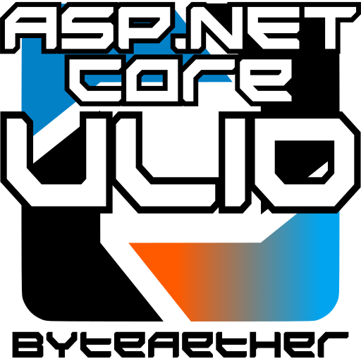
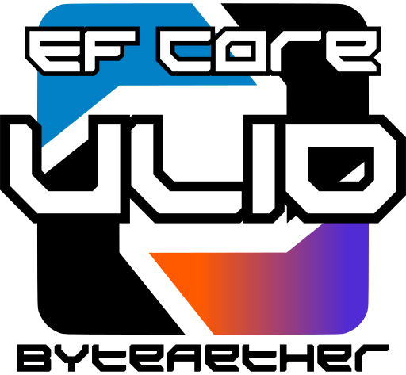
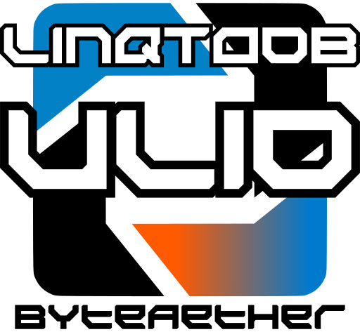
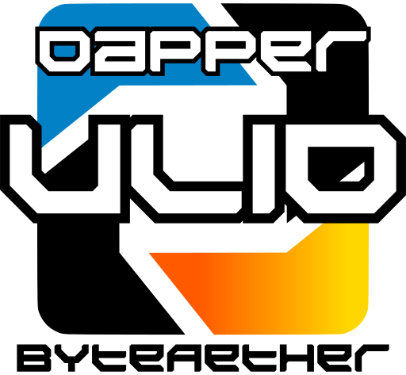
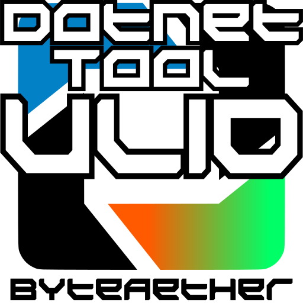

# 

[](https://github.com/ByteAether/Ulid/blob/main/LICENSE)
[](https://www.nuget.org/packages/ByteAether.Ulid/)
[](https://www.nuget.org/packages/ByteAether.Ulid/)
[](https://github.com/ByteAether/Ulid/actions/workflows/build-and-test.yml)
[](https://github.com/ByteAether/Ulid/actions/workflows/codeql.yml)

A .NET implementation of ULIDs (Universally Unique Lexicographically Sortable Identifiers) that follows the [official ULID specification](https://github.com/ulid/spec). Monotonic generation is thread-safe and advances the timestamp when the random part overflows, except at the absolute maximum ULID. Companion packages map ULIDs to Entity Framework Core, LinqToDB, Dapper, and ASP.NET Core.

```sh
dotnet add package ByteAether.Ulid
```

```csharp
using ByteAether.Ulid;

var ulid = Ulid.New();
Console.WriteLine(ulid); // e.g. 01JB5K3R7M9Q2W4X6Y8Z0A1B2C
```

## 📋 Table of contents

- [Introduction](#-introduction)
- [Features](#-features)
- [Packages](#-packages)
- [Installation](#-installation)
- [Usage](#-usage)
- [Documentation](#-documentation)
- [Integration with other libraries](#-integration-with-other-libraries)
- [Benchmarking](#-benchmarking)
- [Acknowledgements](#%EF%B8%8F-acknowledgements)
- [Contributing](#-contributing)
- [License](#-license)

## 📖 Introduction

[](https://www.nuget.org/packages/ByteAether.Ulid/)

A ULID is a 128-bit identifier made of a 48-bit millisecond timestamp and 80 random bits, written as 26 Crockford Base32 characters. It sorts by creation time, which makes it an alternative to GUIDs for distributed systems and time-ordered data. ByteAether.Ulid differs from other ULID libraries in three ways:

- When the 80-bit random part of a monotonic sequence overflows within a millisecond, the timestamp advances by one millisecond. Incrementing the absolute maximum ULID throws `OverflowException`. See [overflow handling](docs/design-notes.md#overflow-handling).
- By default, monotonic IDs generated within one millisecond differ by 1 and are predictable. The opt-in random increments of 1 to 4 bytes keep them strictly ordered and harder to guess. See [mitigating enumeration attacks](docs/design-notes.md#mitigating-enumeration-attacks).
- `System.Guid` is mixed-endian, so databases that store it as-is scramble the big-endian timestamp. Four storage formats (`String`, `Binary`, `Guid` and `SqlServerGuid`) in EF Core, LinqToDB, and Dapper let you choose one that preserves ULID order on your database engine. See [storage formats](docs/storage-formats.md).

For a comparison with UUIDv7 and `Guid.CreateVersion7`, see [ordering within a millisecond compared with UUIDv7](docs/design-notes.md#ordering-within-a-millisecond-compared-with-uuidv7).

## ✨ Features

Each runtime below is a separate build target, and each binary contains optimizations specific to that target.


- **Thread-safe monotonic generation**: IDs generated in sequence strictly increase, including across threads.
- **ULID specification compliance**: String and binary formats, ordering, and parsing follow the specification.
- **Overflow handling**: When the 80-bit random part overflows, monotonic generation advances the timestamp by one millisecond. It throws `OverflowException` only when incrementing the absolute maximum ULID. This follows the workaround from [spec issue #39](https://github.com/ulid/spec/issues/39#issuecomment-2252145597), the one deliberate deviation from the specification.
- **Conversions**: Converts to and from `Guid`, [Crockford's Base32](https://www.crockford.com/base32.html) strings, and byte arrays. `AsByteSpan()` gives zero-allocation access to the bytes except on .NET Standard 2.0, where it returns a copy.
- **Time-range filtering**: `Ulid.MinAt()` and `Ulid.MaxAt()` build the smallest and largest ULID for a timestamp.
- **Database mappings**: EF Core, LinqToDB, and Dapper support four storage formats.
- **Native AOT** compatibility.

## 📦 Packages

- [`ByteAether.Ulid`](https://www.nuget.org/packages/ByteAether.Ulid/) is the `Ulid` type with generation, parsing, conversion, and JSON serialization. Targets .NET 10.0 to .NET Standard 2.0.
- [`ByteAether.Ulid.EntityFrameworkCore`](https://www.nuget.org/packages/ByteAether.Ulid.EntityFrameworkCore/) maps ULIDs in Entity Framework Core. Requires EF Core 6.0.0+.
- [`ByteAether.Ulid.linq2db`](https://www.nuget.org/packages/ByteAether.Ulid.linq2db/) maps ULIDs in LinqToDB. Requires LinqToDB 6.0.0+.
- [`ByteAether.Ulid.Dapper`](https://www.nuget.org/packages/ByteAether.Ulid.Dapper/) maps ULIDs in Dapper. Requires Dapper 2.0.4+.
- [`ByteAether.Ulid.AspNetCore`](https://www.nuget.org/packages/ByteAether.Ulid.AspNetCore/) adds a `:ulid` route constraint, link generation, and OpenAPI schemas. Requires ASP.NET Core 6.0+.
- [`ByteAether.Ulid.Cli`](https://www.nuget.org/packages/ByteAether.Ulid.Cli/) generates and inspects ULIDs in a terminal or script. Requires .NET 6.0+.

## 💾 Installation

Install the latest stable package via NuGet:
```sh
dotnet add package ByteAether.Ulid
```
To install a specific [preview version](https://www.nuget.org/packages/ByteAether.Ulid/absoluteLatest), use the `--version` option:
```sh
dotnet add package ByteAether.Ulid --version <VERSION_NUMBER>
```

## 🚀 Usage

Generate, convert, and parse a ULID:
```csharp
using System;
using ByteAether.Ulid;

// Create a new ULID
var ulid = Ulid.New();

// Convert to byte array and back
byte[] byteArray = ulid.ToByteArray();
var ulidFromByteArray = Ulid.New(byteArray);

// Convert to GUID and back
Guid guid = ulid.ToGuid();
var ulidFromGuid = Ulid.New(guid);

// Convert to string and back
string ulidString = ulid.ToString();
var ulidFromString = Ulid.Parse(ulidString);

Console.WriteLine($"ULID: {ulid}, GUID: {guid}, String: {ulidString}");
```

### Time-range filtering

A ULID embeds a millisecond-precision timestamp and sorts lexicographically, so `Ulid.MinAt()` and `Ulid.MaxAt()` can produce the boundaries of a time window. The same boundaries work for in-memory collections, LINQ queries, and parameterized SQL:

```csharp
Ulid minBoundary = Ulid.MinAt(DateTimeOffset.UtcNow.AddDays(-7));
Ulid maxBoundary = Ulid.MaxAt(DateTimeOffset.UtcNow);

// In memory
var filteredItems = localItems
	.Where(item => item.Id >= minBoundary && item.Id <= maxBoundary);

// In a database: bind minBoundary to @Min and maxBoundary to @Max
var query = "SELECT * FROM Records WHERE Id >= @Min AND Id <= @Max";
```

> [!IMPORTANT]
> Database-side range comparisons and `ORDER BY` follow the ULID order only if the storage format and the database engine preserve its byte order. `Binary` does on every engine; `String` requires a binary or ordinal collation. `Guid` and `SqlServerGuid` depend on the engine. See [storage formats](docs/storage-formats.md) before running database-side range queries.

### Generation options

Pass a `GenerationOptions` instance to set the monotonicity and the source of randomness. The instance owns the monotonic sequence, so create it once and reuse it:

```csharp
using System;
using ByteAether.Ulid;
using static ByteAether.Ulid.Ulid.GenerationOptions;

var options = new Ulid.GenerationOptions
{
	Monotonicity = MonotonicityOptions.MonotonicRandom2Byte
};

// Both ULIDs belong to the same monotonic sequence
var first = Ulid.New(options);
var second = Ulid.New(options);
```

Application-wide defaults, the `Monotonicity` values, and the random sources are described in [generation options](docs/generation-options.md).

## 📚 Documentation

- [API reference](docs/api.md) lists the creation, parsing, conversion, and comparison members of `Ulid`.
- [Generation options](docs/generation-options.md) covers monotonicity, random sources, and application-wide defaults.
- [Storage formats](docs/storage-formats.md) shows which database format keeps ULID order on which engine.
- [Serialization](docs/serialization.md) has recipes for `System.Text.Json`, Newtonsoft.Json, and MessagePack.
- [Design notes](docs/design-notes.md) explain overflow handling, enumeration attacks, UUIDv7, and `Guid` byte order.

## 🔌 Integration with other libraries

### ASP.NET Core

[](https://www.nuget.org/packages/ByteAether.Ulid.AspNetCore/)

[](https://github.com/ByteAether/Ulid/blob/main/LICENSE)

[](https://www.nuget.org/packages/ByteAether.Ulid.AspNetCore/)
[](https://www.nuget.org/packages/ByteAether.Ulid.AspNetCore/)

This companion package is optional. The core `ByteAether.Ulid` library already supports ULIDs as ASP.NET Core route and query parameters through its built-in `TypeConverter`, and serializes ULIDs as strings with `System.Text.Json`. The companion package adds a `:ulid` route constraint that matches only valid ULIDs, typed `Ulid` route link generation, and OpenAPI schema support for Swashbuckle and built-in ASP.NET Core OpenAPI.

```sh
dotnet add package ByteAether.Ulid.AspNetCore
```

```csharp
using ByteAether.Ulid;
using ByteAether.Ulid.AspNetCore;

var builder = WebApplication.CreateBuilder(args);
builder.Services.AddUlidRouteConstraint();

var app = builder.Build();
app.MapGet("/users/{id:ulid}", (Ulid id) => Results.Ok(id));
app.Run();
```

More details in the package's [PACKAGE.md](./src/AspNetCore/PACKAGE.md) file.

### System.Text.Json (.NET 5.0+)

Includes a `JsonConverter` for serialization and deserialization. Recipes for Newtonsoft.Json and MessagePack are in [serialization](docs/serialization.md).

### Entity Framework Core

[](https://www.nuget.org/packages/ByteAether.Ulid.EntityFrameworkCore/)

[](https://github.com/ByteAether/Ulid/blob/main/LICENSE)

[](https://www.nuget.org/packages/ByteAether.Ulid.EntityFrameworkCore/)
[](https://www.nuget.org/packages/ByteAether.Ulid.EntityFrameworkCore/)


```sh
dotnet add package ByteAether.Ulid.EntityFrameworkCore
```

Register the ULID conventions in your `DbContext` with a storage format (`String` by default, `Binary`, `Guid`, or `SqlServerGuid`). The call maps both `Ulid` and `Ulid?`:

```csharp
using Microsoft.EntityFrameworkCore;
using ByteAether.Ulid;
using ByteAether.Ulid.EntityFrameworkCore;

protected override void ConfigureConventions(ModelConfigurationBuilder configurationBuilder)
{
	configurationBuilder.RegisterUlid(UlidStorageFormat.Binary);
}
```

Per-property converters are available for mixed formats. More details in the package's [PACKAGE.md](./src/EFCore/PACKAGE.md) file.

### LinqToDB

[](https://www.nuget.org/packages/ByteAether.Ulid.linq2db/)

[](https://github.com/ByteAether/Ulid/blob/main/LICENSE)

[](https://www.nuget.org/packages/ByteAether.Ulid.linq2db/)
[](https://www.nuget.org/packages/ByteAether.Ulid.linq2db/)


```sh
dotnet add package ByteAether.Ulid.linq2db
```

Register the ULID conventions on your `DataOptions` with a storage format (`String` by default, `Binary`, `Guid`, or `SqlServerGuid`). The call maps both `Ulid` and `Ulid?`:

```csharp
using ByteAether.Ulid;
using LinqToDB;
using ByteAether.Ulid.LinqToDB;

var options = new DataOptions()
	.UseSQLite()
	.UseConnectionString(connectionString)
	.RegisterUlid(UlidStorageFormat.Binary);
```

More details in the package's [PACKAGE.md](./src/LinqToDB/PACKAGE.md) file.

### Dapper

[](https://www.nuget.org/packages/ByteAether.Ulid.Dapper/)

[](https://github.com/ByteAether/Ulid/blob/main/LICENSE)

[](https://www.nuget.org/packages/ByteAether.Ulid.Dapper/)
[](https://www.nuget.org/packages/ByteAether.Ulid.Dapper/)


```sh
dotnet add package ByteAether.Ulid.Dapper
```

Call `DapperUlid.RegisterUlid()` during application startup, before executing queries. It takes a storage format (`String` by default, `Binary`, `Guid`, or `SqlServerGuid`) and maps both `Ulid` and `Ulid?` globally:

```csharp
using ByteAether.Ulid;
using ByteAether.Ulid.Dapper;

DapperUlid.RegisterUlid(UlidStorageFormat.Binary);
```

> [!NOTE]
> Dapper maps .NET types globally using a 1:1 scheme (`Type` → `TypeHandler`). A single global storage strategy applies to the entire application lifecycle.

More details in the package's [PACKAGE.md](./src/Dapper/PACKAGE.md) file.

### Command-line tool

[](https://www.nuget.org/packages/ByteAether.Ulid.Cli/)

[](https://github.com/ByteAether/Ulid/blob/main/LICENSE)
[](https://www.nuget.org/packages/ByteAether.Ulid.Cli/)
[](https://www.nuget.org/packages/ByteAether.Ulid.Cli/)


A .NET tool that generates and inspects ULIDs from the command line. It requires an installed .NET runtime.

Install globally as a .NET tool:

```sh
dotnet tool install -g ByteAether.Ulid.Cli
```

Or install locally in your repository or project:

```sh
dotnet new tool-manifest # if not already present
dotnet tool install ByteAether.Ulid.Cli
```

When installed globally, run `ulid`. When installed locally, prefix commands with `dotnet ulid`.

```sh
# Generate a single ULID
ulid

# Generate 5 ULIDs formatted as GUIDs
ulid -c 5 -f guid

# Inspect a ULID
ulid 01M3PGJEG0BNKP4HVTSFWH61C7

# Inspect from stdin and output as JSON
echo "01M3PGJEG0BNKP4HVTSFWH61C7" | ulid --json
```

More details in the package's [PACKAGE.md](./src/Cli/PACKAGE.md) file.

## 📊 Benchmarking

The benchmarks use [BenchmarkDotNet](https://github.com/dotnet/BenchmarkDotNet) and compare [NetUlid](https://github.com/ultimicro/netulid) 2.1.0, [Ulid](https://github.com/Cysharp/Ulid) 1.4.1, [NUlid](https://github.com/RobThree/NUlid) 1.7.3, and `Guid` on the operations they share: creation, parsing, and byte conversion.

### Configurations

| Name                                       | Configuration                                                                                                                                                         |
|--------------------------------------------|-----------------------------------------------------------------------------------------------------------------------------------------------------------------------|
| `ByteAetherUlid`                           | In `Generate`: default options (cryptographically secure initial source, monotonic +1). In `GenerateNonMono`: non-monotonic, cryptographically secure initial source. |
| `ByteAetherUlidR1Bc`, `ByteAetherUlidR4Bc` | Monotonic generation with a cryptographically secure random increment of 1 or 4 bytes.                                                                                |
| `ByteAetherUlidR1Bp`, `ByteAetherUlidR4Bp` | Monotonic generation with a pseudo-random increment of 1 or 4 bytes.                                                                                                  |
| `ByteAetherUlidP`                          | Non-monotonic generation with a pseudo-random initial source.                                                                                                         |

Results:

```
BenchmarkDotNet v0.15.8, Windows 10 (10.0.19044.7807/21H2/November2021Update)
AMD Ryzen 7 3700X 3.60GHz, 1 CPU, 8 logical and 4 physical cores
.NET SDK 10.0.403
  [Host]     : .NET 10.0.14 (10.0.14, 10.0.1426.52326), X64 RyuJIT x86-64-v3
  DefaultJob : .NET 10.0.14 (10.0.14, 10.0.1426.52326), X64 RyuJIT x86-64-v3

Job=DefaultJob

| Type            | Method             | Mean        | Error     | Gen0   | Allocated |
|---------------- |------------------- |------------:|----------:|-------:|----------:|
| Generate        | ByteAetherUlid     |  38.9911 ns | 0.1723 ns |      - |         - |
| Generate        | ByteAetherUlidR1Bp |  43.5141 ns | 0.0955 ns |      - |         - |
| Generate        | ByteAetherUlidR4Bp |  45.3913 ns | 0.0752 ns |      - |         - |
| Generate        | ByteAetherUlidR1Bc |  84.8688 ns | 0.2517 ns |      - |         - |
| Generate        | ByteAetherUlidR4Bc |  87.6594 ns | 0.1274 ns |      - |         - |
| Generate        | NetUlid *(1)       | 163.1374 ns | 0.5344 ns | 0.0095 |      80 B |
| Generate        | NUlid *(2)         |  49.4282 ns | 0.0978 ns |      - |         - |

| GenerateNonMono | ByteAetherUlid     |  86.6216 ns | 0.2064 ns |      - |         - |
| GenerateNonMono | ByteAetherUlidP    |  38.6569 ns | 0.2780 ns |      - |         - |
| GenerateNonMono | Ulid *(3,4)        |  40.3318 ns | 0.1567 ns |      - |         - |
| GenerateNonMono | NUlid              |  94.7681 ns | 0.7633 ns |      - |         - |
| GenerateNonMono | Guid *(5)          |  50.6460 ns | 1.0274 ns |      - |         - |
| GenerateNonMono | GuidV7 *(3,5)      |  80.2005 ns | 0.7630 ns |      - |         - |

| FromByteArray   | ByteAetherUlid     |   0.7186 ns | 0.0284 ns |      - |         - |
| FromByteArray   | NetUlid            |   1.5241 ns | 0.0397 ns |      - |         - |
| FromByteArray   | Ulid               |   1.3106 ns | 0.0554 ns |      - |         - |
| FromByteArray   | NUlid              |   1.1847 ns | 0.0447 ns |      - |         - |
| FromByteArray   | Guid               |   1.0472 ns | 0.0235 ns |      - |         - |

| FromGuid        | ByteAetherUlid     |   0.6843 ns | 0.0307 ns |      - |         - |
| FromGuid        | NetUlid            |   1.7025 ns | 0.0274 ns |      - |         - |
| FromGuid        | Ulid               |   2.3457 ns | 0.0771 ns |      - |         - |
| FromGuid        | NUlid              |   0.9953 ns | 0.0514 ns |      - |         - |

| FromString      | ByteAetherUlid     |  14.8102 ns | 0.3257 ns |      - |         - |
| FromString      | NetUlid            |  31.0027 ns | 0.6395 ns |      - |         - |
| FromString      | Ulid               |  18.0685 ns | 0.3835 ns |      - |         - |
| FromString      | NUlid              |  68.5845 ns | 0.7484 ns | 0.0086 |      72 B |
| FromString      | Guid               |  22.2173 ns | 0.1978 ns |      - |         - |

| ToByteArray     | ByteAetherUlid     |   4.9374 ns | 0.1565 ns | 0.0048 |      40 B |
| ToByteArray     | AsByteSpan *(6)    |   0.6891 ns | 0.0099 ns |      - |         - |
| ToByteArray     | NetUlid            |  10.8987 ns | 0.2639 ns | 0.0048 |      40 B |
| ToByteArray     | Ulid               |   4.9659 ns | 0.1559 ns | 0.0048 |      40 B |
| ToByteArray     | NUlid              |   9.7095 ns | 0.2187 ns | 0.0048 |      40 B |

| ToGuid          | ByteAetherUlid     |   0.6463 ns | 0.0064 ns |      - |         - |
| ToGuid          | NetUlid            |  10.4726 ns | 0.0409 ns |      - |         - |
| ToGuid          | Ulid               |   1.2504 ns | 0.0281 ns |      - |         - |
| ToGuid          | NUlid              |   0.8496 ns | 0.0133 ns |      - |         - |

| ToString        | ByteAetherUlid     |  16.6631 ns | 0.1906 ns | 0.0095 |      80 B |
| ToString        | NetUlid            |  23.3289 ns | 0.5172 ns | 0.0095 |      80 B |
| ToString        | Ulid               |  20.4262 ns | 0.2208 ns | 0.0095 |      80 B |
| ToString        | NUlid              |  31.3831 ns | 0.6823 ns | 0.0095 |      80 B |
| ToString        | Guid               |   9.0777 ns | 0.1975 ns | 0.0115 |      96 B |

| CompareTo       | ByteAetherUlid     |   1.6627 ns | 0.0629 ns |      - |         - |
| CompareTo       | NetUlid            |   4.1765 ns | 0.0960 ns |      - |         - |
| CompareTo       | Ulid               |   7.0134 ns | 0.0550 ns |      - |         - |
| CompareTo       | NUlid              |   9.5063 ns | 0.0950 ns |      - |         - |
| CompareTo       | Guid               |   5.0982 ns | 0.0500 ns |      - |         - |

| Equals          | ByteAetherUlid     |   0.9600 ns | 0.0191 ns |      - |         - |
| Equals          | NetUlid            |   2.0379 ns | 0.0524 ns |      - |         - |
| Equals          | Ulid               |   0.9622 ns | 0.0475 ns |      - |         - |
| Equals          | NUlid              |   0.9895 ns | 0.0233 ns |      - |         - |
| Equals          | Guid               |   0.9987 ns | 0.0348 ns |      - |         - |

| GetHashCode     | ByteAetherUlid     |   0.8758 ns | 0.0285 ns |      - |         - |
| GetHashCode     | NetUlid            |   9.2087 ns | 0.2109 ns |      - |         - |
| GetHashCode     | Ulid               |   0.8810 ns | 0.0203 ns |      - |         - |
| GetHashCode     | NUlid              |   6.8864 ns | 0.1668 ns |      - |         - |
| GetHashCode     | Guid               |   0.7581 ns | 0.0384 ns |      - |         - |
```

Notes on the other libraries:

1. `NetUlid`: Monotonicity is confined to one thread and does not hold across concurrent threads.
2. `NUlid`: It has a monotonic random provider (`MonotonicUlidRng`) but no built-in shared state. You must create and keep the generator instance yourself, and wrap it to get thread-safe monotonicity across call sites.
3. `Ulid` (Cysharp) & `GuidV7`: Do not implement monotonicity.
4. `Ulid` (Cysharp): After seeding, it uses the cryptographically insecure `XOR-Shift64` algorithm.
5. Native `Guid` / `GuidV7`: [Microsoft documentation explicitly warns](https://learn.microsoft.com/en-us/dotnet/api/system.guid.newguid?view=net-9.0#remarks) that the underlying RNG is not guaranteed to be cryptographically secure, so they are unsuitable for security-sensitive unique keys.
6. `AsByteSpan`: Returns a `ReadOnlySpan<byte>` over the ULID's own bytes without allocating. The other libraries have no equivalent.

`NetUlid` and `NUlid` also throw `OverflowException` when the random part overflows.

Among the ULID libraries compared, the default ByteAether.Ulid configuration is the fastest or tied on every operation except non-monotonic generation. There Cysharp `Ulid` is faster because it uses a non-cryptographic generator (note 4), and `ByteAetherUlidP` matches it. `Guid` is faster at `ToString`, `GetHashCode`, and non-monotonic generation with the cryptographic default. Of the libraries with monotonic generation, only ByteAether.Ulid keeps the sequence strictly increasing across threads out of the box and advances the timestamp when the random part overflows (notes 1 and 2).

## 🏛️ Acknowledgements

This implementation is based on or inspired by the following projects and specifications:

- [NetUlid](https://github.com/ultimicro/netulid)
- [Ulid](https://github.com/Cysharp/Ulid)
- [NUlid](https://github.com/RobThree/NUlid)
- [Official ULID specification](https://github.com/ulid/spec)
- [Crockford's Base32](https://www.crockford.com/base32.html)

## 🤝 Contributing

To contribute code, fork the repository, create a branch, and open a pull request against `main`. To report a bug or suggest a change, [open an issue](https://github.com/ByteAether/Ulid/issues) with details.

Contributors follow the [Code of Conduct](CODE_OF_CONDUCT.md). Release notes for every version are on the [Releases](https://github.com/ByteAether/Ulid/releases) page.

## 📜 License

This project is licensed under the MIT License. See the [LICENSE](LICENSE) file for details.
